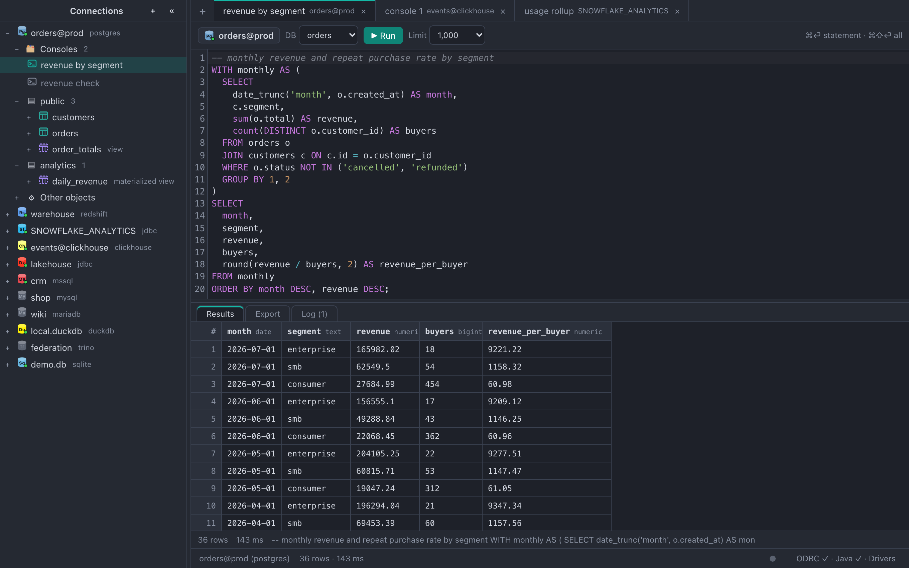
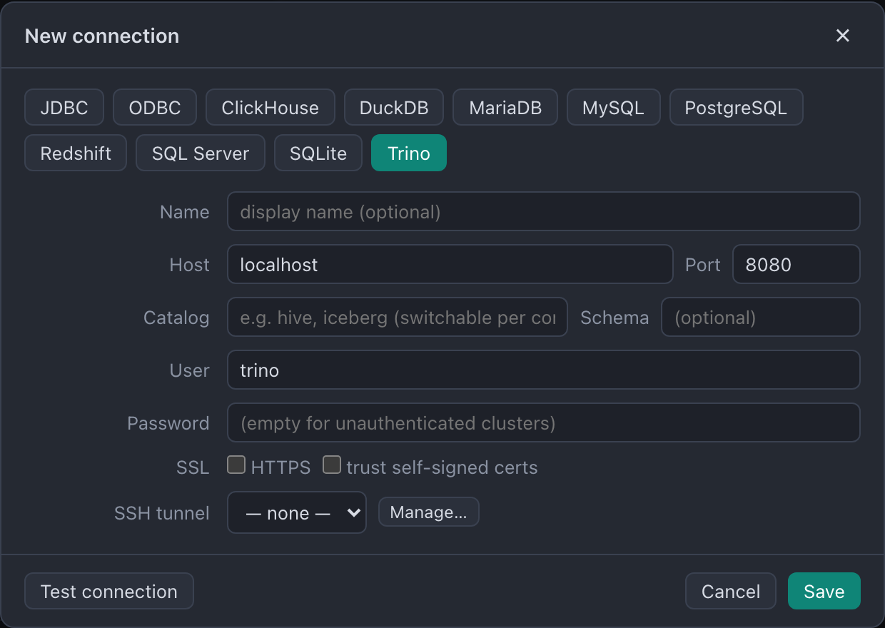
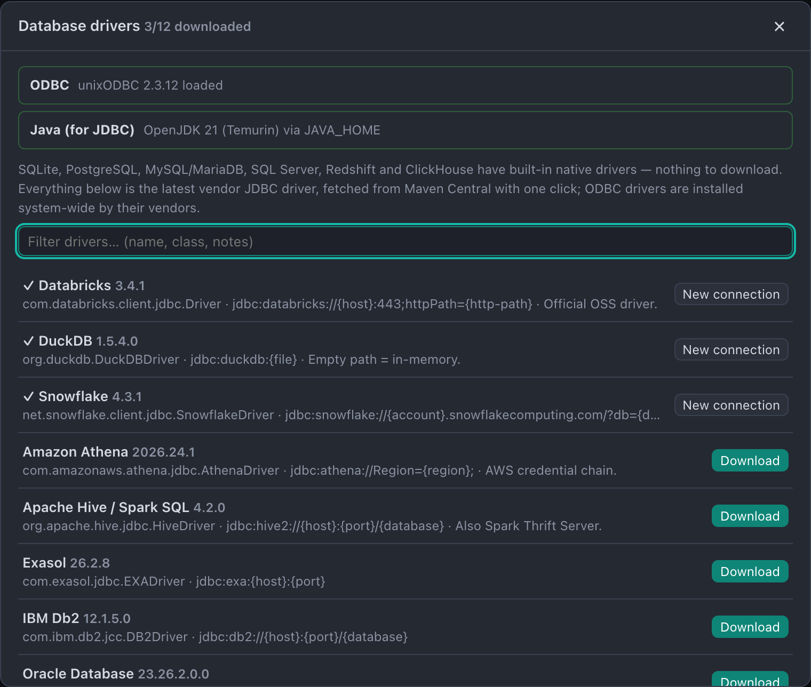

# QueryDeck

A lightweight, cross-platform SQL IDE built with **Tauri 2**, **React**, and **Rust**.
macOS, Windows, Linux.



## Highlights

- **Tabbed consoles, one connection each** — long queries never block another tab.
  `⌘⏎` runs the statement at the cursor, `⌘⇧⏎` the whole script. Consoles persist
  across restarts and closed ones can be reopened (with their logs) from the tree or
  the Open Console dialog.
- **Editor that helps** — schema + query-history autocomplete, dialect-aware
  validation (red squiggles), typo spellcheck that ignores identifiers that aren't
  words, find/replace with regex and case toggles, and one-keystroke reformatting
  (`⌘⌥L`, configurable style).
- **Results built for volume** — virtualized grid over a backend row store, paged
  fetches, automatic row limits, cancellable queries (server-side on PostgreSQL).
- **Schema tree that's instant** — catalogs cache to disk and render immediately on
  launch, then refresh in the background; functions, procedures, sequences, triggers
  and more group under schema → kind, collapsed until you ask.
- **Import / Export** — CSV/TSV import wizard with type inference and column mapping;
  streaming export to CSV, TSV, JSON, SQL INSERTs, or XLSX.
- **Ops-friendly** — status-bar activity dot (queries / background work), Background
  Activity panel with a per-connection kill switch, SSH tunnels, and passwords stored
  in the OS keychain — never on disk.

## Drivers

| | How it works | Setup |
| --- | --- | --- |
| **JDBC** | JNI bridge, JVM discovered at runtime — anything with a JDBC driver | Java 11+ (e.g. [Temurin](https://adoptium.net)) |
| **ODBC** | thin binding loaded at runtime — anything with an ODBC driver | Windows: built in · macOS: `brew install unixodbc` · Debian: `apt install unixodbc` |
| Native | SQLite · DuckDB · PostgreSQL · Amazon Redshift · MySQL · MariaDB · SQL Server · ClickHouse · Trino — pure-Rust drivers, zero setup | none |

The driver manager downloads the latest official JDBC driver for **27 engines** from
Maven Central with one click — Snowflake, Databricks, Oracle, Db2, Teradata, Vertica,
Exasol, SAP HANA, Athena, Hive/Spark, Presto, Informix, Firebird, and more — and the
JDBC connection form prefills any of them from a preset dropdown.

<p>
  
  
</p>

## Development

Prereqs: Rust (stable), Node 20+.

```bash
npm install
npm run tauri dev     # run the app
npm run tauri build   # installers/bundles for the current OS

cd src-tauri && cargo test   # engine tests
npx tsc --noEmit             # typecheck the frontend
```

Opening the vite dev server in a plain browser runs the UI against an in-memory mock
backend (`src/devmock.ts`) — handy for UI work without a database. README screenshots
regenerate with `node scripts/readme-shots.mjs`.

### Architecture

```
src/                    React UI (tabs, editor, grid, tree, wizards)
  store.ts              zustand app state · api.ts — typed invoke wrappers
  components/           SqlEditor (CodeMirror 6), ResultsGrid (virtualized), …
src-tauri/src/
  drivers/              DbConnection trait + sqlite/duckdb/postgres/mysql/mssql/clickhouse/trino/odbc/jdbc
  state.rs              sessions (one per profile+tab), result store, cancel flags
  catalog.rs, ddl.rs    introspection model + DDL generation
  objects.rs            functions/procedures/sequences/triggers per dialect
  transfer.rs           CSV import + streaming export · registry.rs — JDBC downloads
  secrets.rs            OS keychain storage for passwords
```
